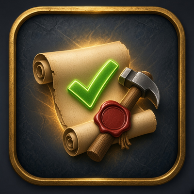
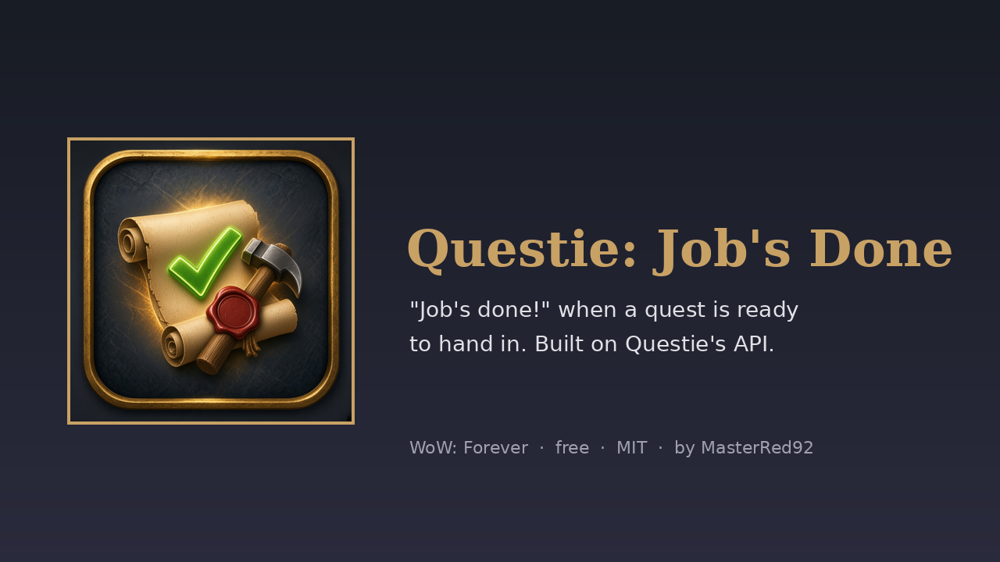
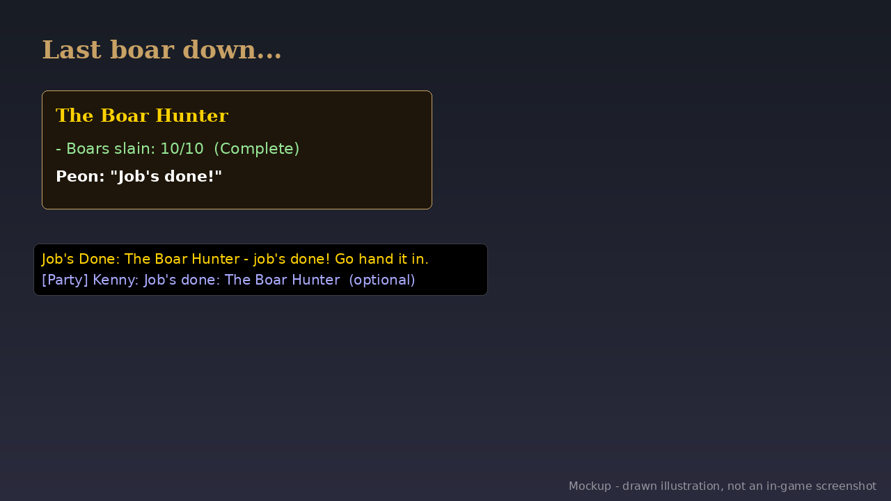

# Questie: Job's Done (WoW: Forever) v1.1.0

   

Finish the last kill or pick up the last item and the peon says **"Job's done!"**. A line in chat tells you which quest is ready to hand in.

- **Uses Questie's public API.** It fires when Questie reports that a quest's objectives are done, once per quest, and again for repeatable quests after you turn them in.
- **Voices:** Peon "Job's done!" (default), Peon "Ready to work!" or Peasant "Ready to work." (`/jd voice`).
- **Plays nicely with Questie's own sound.** Questie has its own quest-complete sound option, off by default. If you turn it on, this addon goes quiet and only prints the chat line, so you never hear two sounds. The lines are also added to LibSharedMedia, so you can pick them in Questie's own sound dropdown if you prefer.
- **Optional party line** (`/jd party`, off by default): "Job's done: <quest>" to your 5-player group, at most once every 10 seconds, never in raids.
- Quests that were already complete when you logged in stay quiet. Sounds come from the client; nothing is bundled.

**Needs:** Required: [Questie](https://www.curseforge.com/wow/addons/questie) 12.3.1 or newer (uses Questie's public API).

**Works with:** Questie (required). Never talks over BRBoss, Wipe & Win Lines or a Grunt Count countdown.

## Download
- **Wago Addons:** coming at launch (Nov 4). The link goes here when the project is live.
- **CurseForge:** maybe later.
- **GitHub:** [Releases](https://github.com/masterred92/QuestieJobsDone/releases) (from the first tagged release) · [Issues](https://github.com/masterred92/QuestieJobsDone/issues)
- **More by Kenny:** [NeutralFlip](https://github.com/masterred92/NeutralFlip) · [GoldPerSpot](https://github.com/masterred92/GoldPerSpot) · [all WoW: Forever addons](https://github.com/masterred92/wow-forever-addons)

## Commands
`/jd` help · `/jd test` · `/jd voice` · `/jd party` · `/jd mute` · `/jd quiet`

## Install
Put the `QuestieJobsDone` folder in `World of Warcraft\_forever_\Interface\AddOns\` and restart the game or `/reload`.

## In-game test checklist (launch day)
1. Listed in AddOns with its icon, with Questie enabled.
2. `/jd test` plays 'Job's done!'.
3. Finish a kill quest's last objective: one 'Job's done!' plus a chat line, even if the last kill finishes two objectives.
4. Turn on Questie's own quest-complete sound: this addon stays silent and only prints the line.
5. In a party with `/jd party` on, the party line posts once.

## Licence
MIT. Written from scratch; no code copied from other addons. Free, no paid features. It doesn't automate gameplay: everything it does is a reaction you can see or something you typed.

## Development
`tests/run.sh [path-to-wow-ui-source-forever]` runs `luac -p`, luacheck, the mock-client tests and (with a path) an API check against Blizzard's Forever UI source and the host addons' source. GitHub Actions runs the tests on every push. The release workflow is a manual dry run that builds the zip with [BigWigsMods/packager](https://github.com/BigWigsMods/packager); publishing is switched off until the Wago project ID is added (see the comments in `.github/workflows/release.yml`).
